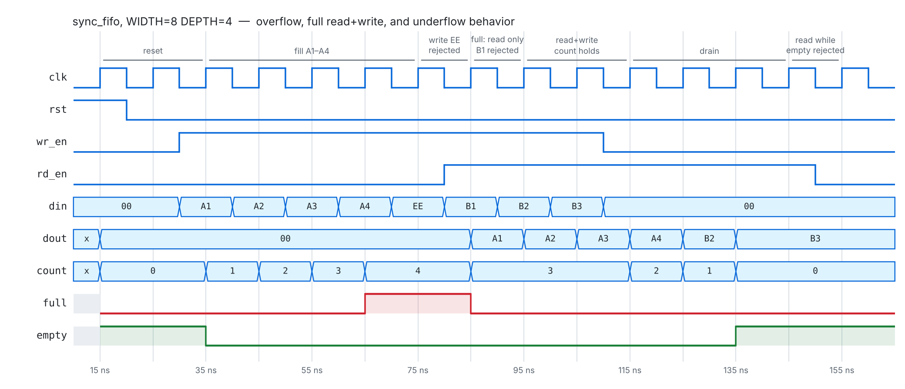

# Parameterized Synchronous FIFO


A synthesizable, parameterized synchronous FIFO implemented in Verilog with a self-checking verification environment. Phase 1 of a FIFO → UART → RV32I project series.

## Features

- Configurable `WIDTH` and `DEPTH`, including non-power-of-two depths
- Synchronous reset
- Single-clock operation
- `wr_en` / `rd_en` controls
- `full` / `empty` status flags
- Occupancy `count`
- FIFO ordering (first in, first out)
- Pointer wrap-around
- Overflow protection
- Underflow protection
- Simultaneous read/write support
- Randomized verification against a behavioral reference model, with functional coverage
- Regression across 7 `WIDTH`/`DEPTH` configurations in GitHub Actions CI

## Architecture

The FIFO stores data in a memory array and tracks two pointers:

- `wr_ptr`: next location to receive a write
- `rd_ptr`: next location to be returned by a read
- `count`: number of valid entries currently stored

```text
                  +----------------------+
      din ------>|                      |
      wr_en ---->|     FIFO Memory      |----> dout
                 |                      |
                 +----------+-----------+
                            ^
                       wr_ptr / rd_ptr
                            |
                 +----------+-----------+
                 |                      |
                 | Occupancy Counter    |
                 |       count          |
                 +----+------------+----+
                      |            |
                    empty        full
```

The design uses `count` to distinguish empty and full states. Both states can otherwise have the pointers at the same relative position after wrap-around, so the occupancy count removes that ambiguity.

## Operation

A write is accepted when:

```text
wr_en = 1 AND FIFO is not full
```

A read is accepted when:

```text
rd_en = 1 AND FIFO is not empty
```

If both operations are accepted during the same clock edge, one item is removed and one item is inserted, so occupancy remains unchanged.

At full capacity, a simultaneous read/write accepts the read but rejects the write because the design evaluates `full` from the pre-edge state.

## Waveform



Fill to full, a write rejected while full, a read+write while full (only the read is accepted), read+write in the middle (`count` holds), drain to empty, and a read rejected while empty. Generated by `tb/waveform_tb.v` (`make waveform`).

## Verification

`tb/sync_fifo_tb.v` is self-checking. Every check either passes or is reported with its name and simulation time, and the run ends in `TEST PASSED` or a `$fatal` with a non-zero exit code.

**Directed tests:**

1. Reset
2. Fill to full
3. Overflow rejection
4. FIFO ordering while draining
5. Empty state
6. Underflow rejection (`dout` unchanged)
7. Simultaneous read/write
8. Pointer wrap-around
9. Reset while holding data (old data never comes back out)

**Randomized test:** 4,000 cycles of random `wr_en`/`rd_en`/`din`, checked every cycle against a behavioral reference model for `dout`, `count`, `full` and `empty`. `dout` is also checked to hold on cycles with no accepted read. The run cycles through balanced (50/50), write-heavy (80/20) and read-heavy (20/80) phases, so large FIFOs still reach full and empty.

**Functional coverage:** the testbench counts each corner case and fails if any was never hit. Example at `WIDTH=8, DEPTH=16`:

| Corner case | Hits |
|---|---|
| Write while full | 771 |
| Read while empty | 743 |
| Read+write, neither full nor empty | 428 |
| Read+write while full | 154 |
| Read+write while empty | 158 |

**Configuration sweep:** `make` runs the same testbench at `WIDTH:DEPTH` = 8:4, 8:2, 8:3, 8:5, 8:16, 16:16 and 32:33, which covers non-power-of-two depths. About 16,000 checks per configuration.

**Bug-injection check:** to confirm the testbench actually detects errors, these bugs were planted in the RTL one at a time. Each one failed the run:

- write accepted while full
- read accepted while empty
- pointer wrapping at the wrong index
- `count` changing on a simultaneous read+write
- `dout` changing on a cycle with no read

**Synthesis:** synthesizes cleanly with Yosys (`synth`). The default 8x16 configuration uses 128 flip-flops for storage and 21 for pointers, `count` and `dout`.

## Run

Requirements: Icarus Verilog 11+ (`iverilog`, `vvp`) and `make`. GTKWave is optional.

```text
make           # run the testbench on every configuration
make sim       # run only the default configuration (8x4)
make waveform  # regenerate the waveform VCD
make wave      # open the default run in GTKWave
make clean     # remove build outputs
```

On Windows without `make`:

```text
scripts\run_tests.bat
```

CI (GitHub Actions) runs the full sweep on every push.

## Design Notes

`COUNT_WIDTH` is `$clog2(DEPTH+1)` because `count` must represent every occupancy from `0` through `DEPTH`.

The pointer width is based on `DEPTH` rather than `DEPTH+1` because pointers identify storage locations, not occupancy levels. Explicit wrap-around logic returns each pointer to zero after the final memory location.

Memory contents do not need to be cleared when reading. Once `rd_ptr` advances, the old entry is no longer logically part of the FIFO.

## Scope

This is a synchronous FIFO. Clock-domain crossing and asynchronous FIFO techniques are intentionally outside the scope of this project.
